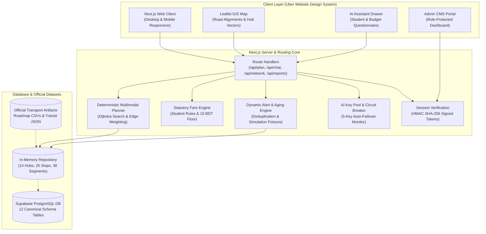

# DhakaPath (ঢাকা-পাথ)

> **Next-Generation Multimodal Transit Navigation, Statutory Fare Intelligence & Dynamic Disruption Awareness for Greater Dhaka**

[](tests/runner.ts)
[-000000.svg>)](https://nextjs.org/)
[](https://www.typescriptlang.org/)
[](<>)

---

## 1. Project Overview

**DhakaPath** is a production-grade multimodal public transit routing and dynamic disruption awareness platform specifically architected for the complex mobility landscape of Greater Dhaka.

Unlike traditional navigation apps that treat travel as private automobile trips or provide static point-to-point lines, DhakaPath models the true everyday reality of a Dhaka commuter: seamlessly chaining elevated **MRT Line 6 Metro Rail**, licensed **arterial city buses** (e.g., Bikolpo, Prochesta), high-headway **Hatirjheel & Banasree Legunas** (human haulers), and non-motorized **last-mile feeder Rickshaws** into realistic intermodal itineraries.

The platform couples a high-speed deterministic transit graph with statutory fare rules (including Bangladesh government student concession formulas), real-time citizen-verified street disruption rerouting, and a bilingual conversational transit AI assistant (fluent in English, বাংলা, and Banglish).

---

## 2. Problem Statement

Dhaka is one of the densest megacities in the world, home to over 20 million residents experiencing catastrophic traffic congestion and fragmented transit infrastructure:

1. **Information Silos & Informal Modes:** No single source models how rapid rail (MRT Line 6) integrates with arterial buses, informal legunas, and local rickshaws. Commuters frequently make unnecessary transfers or overpay.
2. **Statutory Fare Opacity & Student Extortion:** The BRTA statutory bus tariff rules and 50% student concession regulations (with mandatory minimum 10 BDT floors) are notoriously opaque, resulting in daily disputes between conductors and commuters.
3. **Unpredictable Micro-Disruptions:** Flash waterlogging (e.g., Malibagh Railgate, Kazipara), VIP motorcade diversions, protests, or localized water pipe repairs instantly break traditional travel routes without live rerouting alternatives.
4. **Language & Interface Friction:** Existing global transit apps fail to understand colloquial Bangladeshi commute terminology such as _"Shahbagh theke Badda jabo, budget 50 taka, ami student"_ or _"Malibagh block, alternative ache?"_.

---

## 3. Our Solution

DhakaPath solves these critical urban challenges through four unified pillars:

1. **Multimodal Graph Routing Engine:** Deterministic Dijkstra search across verified Dhaka transit corridors that honors physical inter-hub connections, walking transfers, and realistic mode switching.
2. **Statutory Fare & Concession Engine:** Strict statutory fare calculations that apply distance-graduated MRT rules, flat bus tariffs, 50% student discounts with government 10 BDT minimum floor guarantees, and non-metered negotiated rickshaw ranges.
3. **Honest Routing & Dynamic Rerouting:** When links are severed (e.g., flash waterlogging or blockades), the engine either computes an audited detour bypassing the affected corridor or honestly informs the user that no valid route exists without inventing phantom connections.
4. **Bilingual AI Transit Assistant with Multi-Key Failover:** A conversational interface powered by Google Gemini with an automatic 5-key circuit breaker and deterministic fallback, extracting origin, destination, student status, and budget constraints from English and Banglish queries.

---

## 4. Key Features

### 🚇 Core Multimodal Route Planning

- Multi-tier transit routing supporting **Metro Rail (MRT-6)**, **Bikolpo Bus**, **Prochesta Bus**, **Banasree-Gulshan Leguna**, and **Feeder Rickshaws**.
- Realistic transfer waypoints with designated boarding landmarks (e.g., _"Elevated Concourse Gate 1"_, _"Police Box Counter East Side"_).
- Interactive Leaflet vector map displaying authentic road-aligned polylines and turn points derived from official road geometry.

### 💰 Smart Fare Calculation & Concession Rules

- **Full Fare Breakdown:** View exact per-leg costs and cumulative journey tariffs.
- **Student Concession Guarantee:** Enforces statutory $\lceil \text{Regular Fare} \times 0.5 \rceil$ with an unyielding 10 BDT floor on city buses.
- **Budget Categorization:** Automatically flags routes as `WITHIN_BUDGET`, `MAY_EXCEED_BUDGET`, or `EXCEEDS_BUDGET`.
- **Single-Ride Charging:** Continuous bus travel is charged as a single fare without charging duplicate minimum-fare penalties across intermediate graph stops.

### ⚠️ Dynamic Rerouting & Simulation Benchmarks

- Real-time road and hub alerts for waterlogging, construction, and congestion.
- Before-and-after simulation switcher demonstrating detours (e.g., Malibagh waterlogging detour via Gulshan & Mohakhali).
- Honest route reporting: Guarantees zero phantom routes when corridors are impassable (e.g., Rampura Feeder Blockade).

### 🤖 AI Commute Assistant (English & Banglish)

- Built-in interactive questionnaire: Prompts user for **Student Status** (Yes/No) and **Target Budget** ($\le$ 30, 50, 80, 100 ৳).
- Natural language intent extraction supporting colloquial Banglish phrases (_"Uttara theke Motijheel jabo ami student budget 50"_).
- Instant map synchronization: Direct polyline plotting when AI returns route recommendations.

### 🛺 Shared Commute & Fare Splitter Bot (Uber Pool Style)

- Community board for carpooling and splitting CNG auto-rickshaw (up to 4 seats) and feeder rickshaw (up to 2 seats) fares.
- Mathematical per-person split formula ($\lceil \text{Total Fare} \div \text{Commuters} \rceil$) with live savings calculations (save up to 75% vs solo trips).

### 🛡️ Protected Transit Administration CMS

- Role-based protected portal (`/admin`) visible exclusively to authenticated administrative users.
- Live Incident Moderation Queue: One-click Approve, Reject, or Resolve actions directly altering live graph weights.
- Multi-Key AI Pool Telemetry: Real-time circuit breaker monitor tracking quota windows, HTTP 429 cooldowns, and automatic failover.

---

## 5. Technology Stack

| Layer                       | Technology                                               | Rationale                                                                                                      |
| --------------------------- | -------------------------------------------------------- | -------------------------------------------------------------------------------------------------------------- |
| **Frontend Framework**      | **Next.js 16.4.2 (App Router & Turbopack)**              | Sub-second cold compilation, streaming server components, and production performance.                          |
| **UI Design System**        | **Mantine UI v7 / v9 + Tabler Icons**                    | Bespoke Uber website monochrome aesthetic (`#000000`, `#FFFFFF`, `#F3F3F3`, `#E2E2E2` borders).                |
| **Mapping Engine**          | **Leaflet.js + OpenStreetMap (CartoDB Positron / Dark)** | Lightweight vector mapping with dynamic multi-color leg polylines, custom hub icons, and zero license lock-in. |
| **Backend & Routing**       | **TypeScript + Next.js Server Route Handlers**           | Fully deterministic graph traversal, in-memory repository caches, and sub-millisecond Dijkstra execution.      |
| **Database & Auth**         | **PostgreSQL (Supabase) + HMAC SHA-256 Tokens**          | Canonical transit datasets, tamper-proof signed session cookies, and declarative RLS security schemas.         |
| **Artificial Intelligence** | **Google Gemini 2.5/Flash API + Key Pool Failover**      | High-speed multi-lingual intent parsing with 5-key adaptive circuit breaker and deterministic local fallback.  |
| **Code Optimization**       | **Rust Token Killer (RTK)**                              | Optimized terminal and shell output streaming during high-speed development.                                   |

---

## 6. System Architecture



---

## 7. Routing Algorithm & Multimodal Logic

The routing engine executes an audited deterministic graph search across Dhaka's transit network:

$$\text{User Query} \longrightarrow \text{Transit Graph} \longrightarrow \text{Constraint Filtering} \longrightarrow \text{Alert Injection} \longrightarrow \text{Dijkstra Search} \longrightarrow \text{Fare Breakdown} \longrightarrow \text{Ranked Routes}$$

1. **Transit Graph Modeling:** The network is represented as a directed graph $G = (V, E)$, where vertices $V$ represent transit stops and intermodal hubs, and edges $E$ represent transit segments (metro, bus, leguna, rickshaw, and pedestrian transfers).
2. **Dynamic Weighting & Disruption Penalty:**
   $$\text{Weight}(e) = \text{Baseline Duration}(e) + \text{Disruption Delay}(e) + \text{Transfer Penalty}(e)$$
   If an edge is marked `is_closed: true` (e.g., complete waterlogging or canal blockade), its edge weight becomes $\infty$, pruning it from the search space.
3. **Multimodal Transfers:** Walking connectors between bus counters and elevated metro concourses (e.g., Farmgate, Shahbagh, Karwan Bazar) are explicitly modeled with realistic 2–3 minute walking penalties.
4. **Alternative Route Ranking:** Returns multiple ranked travel options (Fastest, Lowest Cost, Minimal Transfers, and Metro Priority).
5. **Honest Routing Guarantee:** If no path exists connecting origin to destination (e.g., during severe canal blockades or unsupported outer districts), the engine returns an honest `NO_ROUTE_FOUND` status rather than fabricating non-existent transit links.

---

## 8. AI Integration & Grounding

The conversational transit assistant is built with strict architectural grounding to prevent AI hallucinations:

1. **Intent Extraction:** Natural language input is parsed to extract:
   - `originHubId` & `destinationHubId` (resolved via fuzzy alias matching against Dhaka's 14 hubs)
   - `student` (boolean status for concession calculations)
   - `budgetBdt` (maximum allowable fare threshold)
   - `avoidHubIds` (corridors to route around, e.g., _"avoid Malibagh"_)
2. **Contextual Memory:** Multi-turn session persistence allows users to refine existing journeys (_"Ami student"_ or _"Budget 30 taka"_ updates previous origin-destination context).
3. **Graph Grounding:** The AI never invents routes or fares. All recommendations are directly computed by `planTrip()` and validated against official tariff schedules before being presented to the commuter.
4. **Key Pool Circuit Breaker:** Connects 5 Google Gemini API keys in an automated pool. If Key #1 encounters HTTP 429 rate-limiting, the system isolates it for a 45-second cooldown and automatically routes the prompt to the next healthy key with zero user disruption. If all keys are exhausted, it seamlessly falls back to local deterministic rule-based parsing.

---

## 9. Data Sources & Official Artifacts

DhakaPath's network geometry and service schedules are grounded in official data artifacts provided for the hackathon:

| File Name                     | Source / Nature             | Role in DhakaPath                                                 |
| ----------------------------- | --------------------------- | ----------------------------------------------------------------- |
| `Roadmap-Dhaka.csv`           | Official Road Network GIS   | Road segment geometries and arterial corridor connectivity.       |
| `Routemap-DhakaMetroRail.csv` | DMTCL Official Data         | Stations, alignments, and distance metrics for MRT Line 6.        |
| `Routemap-BikolpoBus.csv`     | City Bus Syndicate Map      | Mirpur 10 to Motijheel bus stoppages and corridor alignments.     |
| `Routemap-UttaraBus.csv`      | Regional Bus Corridor Map   | Uttara to Central Dhaka arterial bus alignments via Airport Road. |
| `transit-data.json`           | Hackathon Canonical Dataset | Base stops, multimodal hubs, and service frequencies.             |

> **Data Limitation Disclosure:** While official CSVs provide authentic physical road waypoints and station coordinates, live traffic speeds and real-time bus arrivals are simulated based on empirical Dhaka peak-hour observations. Negotiated rickshaw tariffs are computed within verified empirical ranges.

---

## 10. Installation & Configuration

### Prerequisites

- **Node.js:** v18.17.0 or higher (v20+ recommended)
- **Package Manager:** `npm` (v9+)

### 1. Clone the Repository

```bash
git clone https://github.com/jaber-hossain1/DhakaPath.git
cd DhakaPath
```

### 2. Configure Environment Variables

Copy the template or create `.env.local`:

```bash
cp .env.example .env.local
```

Configure your keys in `.env.local`:

```env
NEXT_PUBLIC_SUPABASE_URL=https://hhjqokrevdwbcrhyigwz.supabase.co
NEXT_PUBLIC_SUPABASE_ANON_KEY=your_supabase_anon_key
SUPABASE_SERVICE_ROLE_KEY=your_supabase_service_key
ADMIN_AUTH_SECRET=dhakapath_admin_secret_key_2026_pilot_secure
ADMIN_EMAIL=admin@dhakapath.gov.bd
ADMIN_PASSWORD=dhakapath@admin2026
GEMINI_API_KEY_1=your_gemini_api_key
```

### 3. Install Dependencies

```bash
npm install
```

### 4. Run Development Server

```bash
npm run dev
```

Open [http://localhost:3000](http://localhost:3000) in your browser.

### 5. Run Automated Verification Test Suite

Execute the 18 comprehensive regression tests (routing, student fares, disruption detours, session crypto, and AI failover):

```bash
npm test
```

### 6. Build for Production

```bash
npm run build
npm run start
```

---

## 11. Official Admin Account Details

Authorized transit administrators have elevated access to the protected Operations CMS:

- **Login URL:** [`http://localhost:3000/login`](http://localhost:3000/login)
- **Protected CMS Route:** [`http://localhost:3000/admin`](http://localhost:3000/admin) (Automatically hidden from public navbar; accessible only upon authentication)
- **Email:** `admin@dhakapath.gov.bd`
- **Password:** `dhakapath@admin2026`
- **Capabilities:** Moderate crowd reports, approve/reject street alerts, calibrate delays, and monitor AI key failover health.

---

## 12. Screenshots & User Experience

| Multimodal Route Planner                                           | AI Commute Assistant (Questionnaire Flow)                          |
| ------------------------------------------------------------------ | ------------------------------------------------------------------ |
|               |                     |
| _Streamlined Uber-style trip planner with interactive Leaflet map_ | _Bilingual AI with student status and target budget questionnaire_ |

| Shared Commute & Fare Splitter Bot                              | Protected Operations CMS                                        |
| --------------------------------------------------------------- | --------------------------------------------------------------- |
|  |       |
| _Uber Pool style fare splitting & community ride sharing_       | _Disruption moderation queue, services CMS, & AI key telemetry_ |

---

## 13. Limitations & Future Scope

### Current Pilot Limitations

- **Pilot Geographic Coverage:** Focuses on 14 major multimodal hubs across North, Central, and East Dhaka (Uttara North to Motijheel, Mirpur 10 to Banasree/Badda).
- **Static Sensor Hardware:** Disruption reports rely on citizen crowd-sourcing and official simulation feeds rather than automated IoT road sensors.

### Future Roadmap

1. **GTFS Realtime Integration:** Ingest live GPS feeds from participating Dhaka bus operators.
2. **Digital NFC Ticketing:** Direct top-up integration with Rapid Pass and MRT Pass.
3. **Voice Audio Directions:** Audio guidance in colloquial Bengali for low-literacy commuters.
4. **Predictive Monsoon AI:** Historical machine learning models forecasting waterlogging based on BMD rainfall telemetry.

---

## 14. License

This project was built for the **Dhaka Transit Hackathon 2026**. Licensed under the [MIT License](LICENSE).
